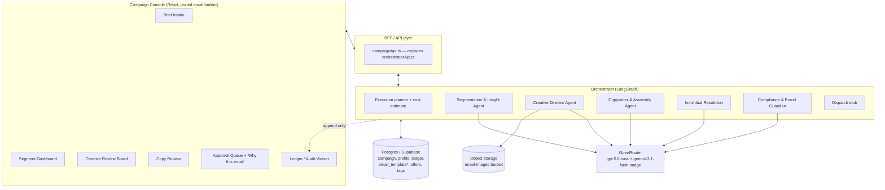

# MOSAIC — Full Application Build Plan

Synthesized from `TEAM_13_Project_Proposal.docx` (the academic scope: 9-stage agent
pipeline, RAI/security requirements, effort table) and
`EMAIL_BUILDER_PORTING_GUIDE.md` (a working block-based email editor + renderer
we already own and are porting in as the Campaign Console's template engine),
targeting a single-provider 2026 stack via **OpenRouter**: **openai/gpt-5.6-luna**
for all text/reasoning agents and **google/gemini-3.1-flash-image** (routed
through OpenRouter's `/images` endpoint) for image generation. OpenRouter was
chosen over calling Google/OpenAI directly so both model families sit behind
one API key and one billing surface — the Orchestrator doesn't care which
underlying provider served a given call, only the model id it requested.

No code yet — this is the architecture, component, data, and milestone plan.

---

## 1. Model & provider decisions

| Need | Model (via OpenRouter) | Notes |
|---|---|---|
| Segment rationale, copy, slot resolution, Guardian judging, LLM-as-judge eval | **openai/gpt-5.6-luna** | One model everywhere text is generated or judged — keeps prompt/version tracking in the Ledger simple (one model id, one version string per call). |
| Image candidates (Creative Director) | **google/gemini-3.1-flash-image** | Called via OpenRouter's `/images` endpoint with the Segment Brief's constrained visual-direction fields as templated prompt inputs — never free text (per the proposal's injection risk mitigation). |
| Image critique / brand adherence / representational-skew scoring | **openai/gpt-5.6-luna (multimodal)** | TODO once wired: attach the candidate image to a chat/completions call against the brand guideline pack — no separate VLM vendor needed as long as the routed model accepts image input. |
| Customer embeddings (free-text portion) for segmentation | **OpenRouter `/embeddings`** (placeholder model `openai/text-embedding-3-small` — confirm it's actually servable via OpenRouter before relying on it; embeddings are less standardised across OpenRouter's providers than chat/images) | Only the sanitised free-text fields get embedded; structured/behavioural attributes are engineered features (one-hot, scaled numerics) concatenated with the text embedding before HDBSCAN. |
| Structured artifact output (Segment Brief, copy slots, Guardian verdict, etc.) | OpenAI-compatible `response_format: json_schema` | Every agent emits typed JSON validated against a schema at the boundary — the Orchestrator never regex-parses free text out of a model response. Falls back to `json_object` mode if the routed model rejects strict schema mode. |

All calls go through one thin wrapper (`backend/app/openrouter_client.py`) that:
injects the OpenRouter API key, tags every call with
`{stage, campaign_id, prompt_version}`, meters cost, and enforces the
per-campaign budget ceiling from the proposal. It talks to OpenRouter over
plain REST (httpx) rather than a provider SDK, so swapping either model id
later is a one-line config change, not a rewrite.

---

## 2. High-level architecture



The Orchestrator does **not** let agents call each other directly (per the
proposal's design principle). Every artifact passes through the shared
blackboard/DB and is schema-validated at the boundary; every stage writes one
row to the append-only Decision Ledger.

---

## 3. Stage-by-stage build plan

| # | Stage | Model usage (via OpenRouter) | Deterministic logic | Storage touched | Console screen |
|---|---|---|---|---|---|
| 0 | Campaign Intake | none (or gpt-5.6-luna to sanity-check brief completeness) | Brief validation, execution plan + cost estimate from historical token/image costs | `campaign`, `offer_catalogue`, `brand_guideline_pack` | Brief Intake |
| 1 | Segmentation & Insight | gpt-5.6-luna for feature-importance rationale text; embeddings for free-text fields | HDBSCAN clustering, cluster-stability check, confidence score | `customer_profile`, `segment_brief` | Segment Dashboard |
| 2 | Visual Generation (per segment) | gpt-5.6-luna drafts concepts + brand-critique reasoning; gemini-3.1-flash-image generates candidates; gpt-5.6-luna (multimodal) critiques | Retry loop up to *k* attempts, safety-classifier gate before storage | `asset_candidate`, `asset_set`, storage bucket | Creative Review Board |
| 3 | Copy Generation (per segment, parallel to 2) | gpt-5.6-luna writes subject/preheader/body/CTA with typed slots, grounded via brand-voice RAG + offer catalogue | Citation check: every claim must reference an `offer_catalogue` row or the agent must refuse | `copy_version` | Copy Review |
| 4 | Template Assembly | none | **Reuses the ported email builder engine** (`EmailBlock[]` → `generateEmailHtml`) instead of building a separate MJML compiler — see §4. Accessibility (alt text, contrast, semantic order), dark-mode check, size check | `email_template` (extended schema) | inline in Creative/Copy Review via `EmailPreview` |
| 5 | Individual Resolution (per recipient) | gpt-5.6-luna only for short NL fragments, tightly scoped | Deterministic slot lookups from `customer_profile`; this is the only per-recipient stage — O(n) | resolved slots (ephemeral or `resolved_message`) | not directly reviewed — sampled in stage 7 |
| 6 | Compliance Adjudication | gpt-5.6-luna as LLM-judge (grounding, manipulation index, protected-attribute proxy) | Consent/suppression check, PII contamination scan, rule engine; verdict PASS / REVISE / BLOCK | `ledger_entry`, `manipulation_score`, `proxy_check_result` | surfaced in Approval Queue |
| 7 | Human Approval Gate | none | Mandatory gate, no bypass flag; stratified sample review | `approval` (named human, timestamp, scope) | Approval Queue + "Why this email" |
| 8 | Dispatch | none | Sandboxed stub send; outcomes written back | `ledger_entry` | Ledger / Audit Viewer |

---

## 4. Frontend — Campaign Console (built from the ported email builder)

Base it on **Path B** from `EMAIL_BUILDER_PORTING_GUIDE.md` (~13,000 LOC:
editor + template library), then extend.

**Kept as-is (Tier 1 + Tier 2 of the guide):**
- `EmailBlock`/`EmailTemplate` data model, `EmailPreview`, `export-html.ts`
  (`generateEmailHtml`), `BlockEditor`, `BlockPalette`, background system,
  `email-sanitize.ts`.
- `use-email-templates.ts` + the four Supabase tables (`email_template*`) —
  each **assembled segment email becomes one `email_template` row**, linked to
  its `campaign_id` and `segment_brief_id`.
- `ImageUpload.tsx` + `email-image-storage.ts` + `email-image-urls.ts` — the
  data-URI → public-HTTPS rewriting is non-negotiable per the guide's Seam 5,
  and it's exactly the mechanism needed to make the image-gen output (which
  comes back as inline base64 data) safe to ship to Gmail mobile.

**Replaced (the guide's seams to cut):**
- Seam 6 (brand defaults): swap M1 branding for **Northbank Living** (the
  proposal's simulated client) — logo, footer, social links, accent colour,
  background presets.
- `AIGenerateTab` backend: point at a real OpenRouter-backed route instead of
  the Vite dev-plugin stub (guide's gotcha #8 — that stub 404s in production).
- `HeroGallery` / Midjourney integration: **replace entirely** with a "Creative
  Director" panel that calls the OpenRouter image endpoint + shows the
  accept/reject critique log the proposal requires ("candidates rejected
  along with the reason"). Kept `HeroGallery.tsx`/`FolderDestPicker.tsx`/
  `imageFoldersApi.ts` themselves (brand-agnostic asset-library UI); only
  `midjourney-client.ts` was replaced, by `nano-banana-client.ts` calling our
  backend's `/api/generate-image`.
- Seam 2 (Auth): the proposal requires approvals and BLOCK-overrides to be
  **recorded by name** — needs at least a minimal named-user identity, even if
  it's just a login-free "pick your name" selector for the demo. Decide scope
  in §10.
- Seam 3 (orchestrator base): new `campaignApi.ts` replacing
  `orchestratorApi.ts`, talking to our own Orchestrator API instead of
  CampaignOS's.
- Translation tab (EN↔ZH): **defer** — not in the proposal's scope; leave
  unported unless the team wants it as a stretch goal.
- Hero image designer (`HeroImageEditor`, DIN fonts, canvas compositing):
  **defer** — not required by the proposal; the `hero-image` block type falls
  back to a plain `ImageBlockEditor` per the guide's Path A step 3.

**New screens (not in the original builder):**
- **Brief Intake** — objective, offer catalogue, guideline pack, budget
  ceiling, hard exclusions; shows the Orchestrator's execution plan + cost
  estimate before committing.
- **Segment Dashboard** — one card per micro-segment: dominant motivation,
  tone guidance, size, confidence, and the feature-contribution rationale
  (stage 1's explainability requirement).
- **Creative Review Board** — per segment, the approved asset set + the
  rejected-candidate log with reasons (stage 2).
- **Copy Review** — slotted copy per segment before resolution (stage 3).
- **Approval Queue + "Why this email"** — the main explainability artifact:
  segment brief → asset set → copy version → resolved slots with source
  fields → Guardian verdict broken down by check, all in one panel, rendered
  using the ported `EmailPreview` for the actual message.
- **Ledger / Audit Viewer** — append-only feed, filterable by campaign/stage/
  agent, showing prompt + model versions live at generation time.

---

## 5. Backend / Orchestrator

- **Runtime:** LangGraph as the graph engine (matches the proposal's stated
  tool choice). Language decision (Python vs. LangGraph.js) is open — see §10.
- **Shape:** a modular monolith (one deployable with clearly separated agent
  modules), not microservices — five stages × two people × 30 days does not
  afford inter-service ops overhead. Internal module boundaries mirror the
  five agents so ownership (OQQ/ABP per the effort table) stays clean.
- **Execution model:** campaign runs are long (segment-level fan-out, then
  thousands of per-recipient resolutions) — needs an async job with a
  status/progress endpoint (polling or SSE), not a single blocking request.
- **Decision Ledger:** append-only Postgres table, insert-only access pattern,
  every row carries `prompt_version`, `model_version`, `input_artifact_ids`,
  `output_artifact_id`, `stage`, `agent`, optional `actor` (human name) for
  approvals/overrides.
- **Cost meter:** wraps every OpenRouter call, tags spend by
  `{campaign, stage, agent}`, enforces the hard budget ceiling — breach halts
  the run and escalates rather than degrading silently (per the proposal's
  risk table).
- **Bounded retries:** revision cycle counters per artifact (Creative Director
  critique loop, Guardian REVISE loop) so a stuck agent can't loop forever
  inside the cost ceiling.

---

## 6. Data architecture

Reuse the four `email_template*` tables from the porting guide unchanged,
plus new tables:

```
campaign               (id, name, objective, budget_ceiling, brand_guideline_pack_id, status, created_by, created_at)
customer_profile       (id, campaign_id, structured_attrs jsonb, behavioural jsonb, psychographic jsonb, free_text, consent_state)
segment_brief          (id, campaign_id, motivation, tone_guidance, visual_direction, exclusions, size, confidence, rationale, feature_contributions jsonb)
asset_candidate        (id, segment_brief_id, image_url, prompt_used, critique_verdict, rejection_reason, model_version)
asset_set              (id, segment_brief_id, approved_candidate_ids[], alt_text)
copy_version           (id, segment_brief_id, subject, preheader, body_slots jsonb, cta, cited_offer_ids[])
offer_catalogue         (id, campaign_id, name, terms, eligibility_rules jsonb)
brand_guideline_pack   (id, name, voice_exemplars, colour/logo/social defaults — feeds the ported builder's BLOCK_DEFAULTS)
consent_suppression    (customer_id, consent_state, suppressed_at)
ledger_entry           (id, campaign_id, stage, agent, input_artifact_ids[], output_artifact_id, prompt_version, model_version, verdict, actor, created_at)
approval               (id, campaign_id, scope, approver_name, decision, created_at)
manipulation_score     (message_id, urgency, scarcity, loss_framing, social_proof, total, threshold_breached)
proxy_check_result     (segment_brief_id, protected_attribute, correlation, flagged)
```

`email_template.folder_id` / `tag` mechanisms from the guide map naturally
onto "one folder per campaign" and "tag = segment" if useful for browsing.

Storage: reuse the existing `email-images` public bucket pattern for both
generated image output and any manually uploaded assets.

---

## 7. Security & Responsible AI implementation

- **Ingestion sanitization:** all customer free text (support notes,
  self-entered profile fields) is sanitised and structurally delimited at
  ingestion, never placed in instruction position in a prompt — this runs
  *before* it ever reaches the embedding step or a brief.
- **Injection corpus:** curated adversarial-input test set, becomes a CI gate;
  Guardian additionally checks generated copy for instruction-like artifacts.
- **PII contamination scanner:** per-recipient rendering runs in an isolated
  context; Guardian scans each resolved message for identifiers that don't
  belong to that recipient — severity 1, blocks the whole batch.
- **Protected-attribute proxy detector:** correlation test between segment
  membership and held-out protected attributes; any segment above threshold
  routes to human review before creative generation starts.
- **Representational-skew check:** vision-capable critic call scores generated
  imagery for demographic skew relative to the brief; over-threshold triggers
  regeneration under an explicit diversity constraint.
- **Grounding verifier:** every factual claim must cite an `offer_catalogue`
  entry; an independent verifier pass checks this at adjudication — an
  ungrounded claim is a BLOCK, not a REVISE.
- **Manipulation index:** lexicon backstop + LLM-judge rubric scoring
  urgency/scarcity/loss-framing/false-social-proof.
- **Golden set + LLM-as-judge:** regression suite calibrated against a small
  human-labelled sample so the judge itself is checked before trusted.
- **Hard-coded ethical exclusions** (from the proposal, enforced in code, not
  just policy): no targeting/varying creative on inferred health, financial
  distress, bereavement, or protected attributes; no individual price
  discrimination beyond defined eligibility rules; no targeting inferred
  emotional vulnerability; no real-person likeness or fabricated
  testimonials in generated imagery — these become literal `assert`/guard
  checks in the Guardian module, not prompt instructions.
- **IMDA Model AI Governance Framework mapping:** tie each control above to
  one of the four pillars (internal governance, human involvement, operations
  management, stakeholder communication) — this is already a required
  deliverable; keep a living table as controls are implemented.

---

## 8. CI/CD & environments

**CI (per proposal, every commit):**
unit tests → agent contract tests (schema validation per agent I/O) →
prompt-injection corpus → PII contamination test → accessibility check
(e.g. axe-core) on rendered HTML output. Prompts live in-repo, reviewed like
code.

**Env vars** (see `backend/.env.example` and `frontend/.env.example` — these
are the actual files in the repo, kept in sync with this list):
```
# backend/.env
OPENROUTER_API_KEY=
OPENROUTER_BASE_URL=https://openrouter.ai/api/v1
OPENROUTER_TEXT_MODEL=openai/gpt-5.6-luna
OPENROUTER_IMAGE_MODEL=google/gemini-3.1-flash-image
OPENROUTER_EMBEDDING_MODEL=openai/text-embedding-3-small   # confirm servable before relying on it
SUPABASE_URL=
SUPABASE_SERVICE_ROLE_KEY=            # service role — never in frontend/.env
CAMPAIGN_BUDGET_CEILING_DEFAULT=150
FRONTEND_ORIGIN=http://localhost:5173

# frontend/.env.local
VITE_SUPABASE_URL=
VITE_SUPABASE_ANON_KEY=               # anon key only — never the service role key
VITE_ORCH_API_BASE=http://localhost:8000
```

**Local dev:** frontend (`npm run dev`, Vite on :5173) + backend
(`uvicorn app.main:app --port 8000`, its own `.venv`) run as two separate
processes today; no Docker Compose yet. No external Resend/Midjourney
dependency (Tier 3 features from the guide are out of scope) — dispatch is a
sandboxed stub per the proposal's assumptions.

---

## 9. Milestones (mapped onto your existing 15-task / 30-day table)

| Proposal task | This plan's concrete deliverable |
|---|---|
| 1. Project setup | Repo skeleton, CI shell, `openrouter_client.py` wrapper with cost meter — **done** |
| 2. Synthetic dataset, guideline pack, offer catalogue, golden set | `customer_profile` seed data (~5,000 rows), `brand_guideline_pack`/`offer_catalogue` tables + Northbank Living content |
| 3. Architecture + contracts | This document + JSON schemas per agent artifact |
| 4. Orchestration backbone | LangGraph graph, Ledger table, budget ceiling enforcement — **done** (segmentation → creative ∥ copy → guardian wired and verified end-to-end against live OpenRouter calls) |
| 5. Segmentation & Insight | Embedding pipeline, HDBSCAN, Segment Dashboard — Console screen done, clustering still stubbed |
| 6. Creative Director | google/gemini-3.1-flash-image integration, critique loop, Creative Review Board — image generation verified live; critique loop still stubbed |
| 7. Copywriter & Assembly | gpt-5.6-luna copy generation (verified live, structured JSON output) + **ported email builder** as the assembly engine (replaces a from-scratch MJML compiler — time saved here should be reinvested in stage 6/8 hardening) |
| 8. Compliance & Brand Guardian | Rule engine + LLM judge + all scanners from §7 — grounding check verified live (correctly BLOCKs uncited claims); other scanners still stubbed |
| 9. Campaign Console | Brief intake + Approval Queue + "Why this email" panel |
| 10. RAI instrumentation | Fairness/skew metrics, IMDA mapping doc |
| 11. AI security test suite | Injection corpus, PII tests, red team |
| 12. CI/CD, versioning, monitoring | Pipeline from §8 + per-stage cost/latency dashboards |
| 13. E2E integration + scaling test | Full 5,000-contact run, cost/latency-per-stage extrapolation |
| 14. Documentation + reports | This plan feeds the architecture doc directly |
| 15. Contingency/rework buffer | as scheduled |

---

## 10. Decisions

1. **Template-assembly engine — DECIDED: reuse the ported email builder**
   (`EmailBlock[]` + `generateEmailHtml`) instead of building MJML from
   scratch. Note this explicitly in the architecture doc as a justified
   deviation from the proposal's literal MJML wording — the reasoning is the
   large scope reduction from reusing code already documented in the porting
   guide.
2. **Orchestrator language — DECIDED: Python.** LangGraph (Python-native) +
   HDBSCAN for segmentation. The React frontend (TS) and Python orchestrator
   communicate over the `campaignApi.ts` REST boundary from §4/§5 — treat this
   as a firm service boundary from day one (typed request/response schemas,
   not shared code).
3. **Named-approver identity:** still open. The proposal requires
   approvals/BLOCK-overrides attributable to a name — options range from a
   full auth system down to a lightweight "select your name" identity for the
   two-person demo. Lightweight is almost certainly sufficient given the team
   size and academic scope; revisit only if the marker expects real auth.
4. **Job execution model:** still open — synchronous polling vs. SSE
   streaming for campaign-run progress in the Console, given stage 5 fans out
   to thousands of per-recipient resolutions. Polling is simpler to build and
   sufficient at this scale; SSE is nicer UX but not load-bearing for the
   proposal's requirements.
