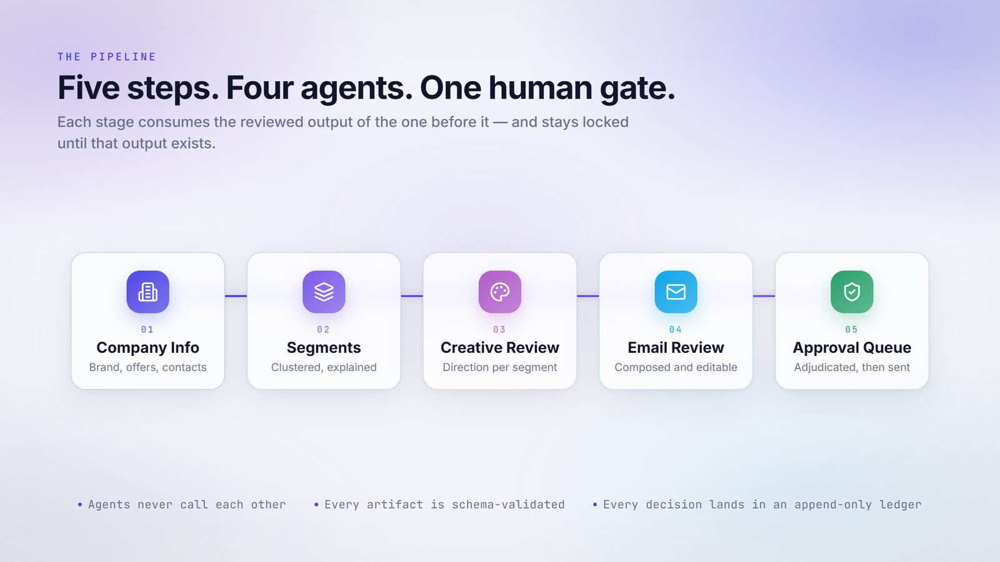
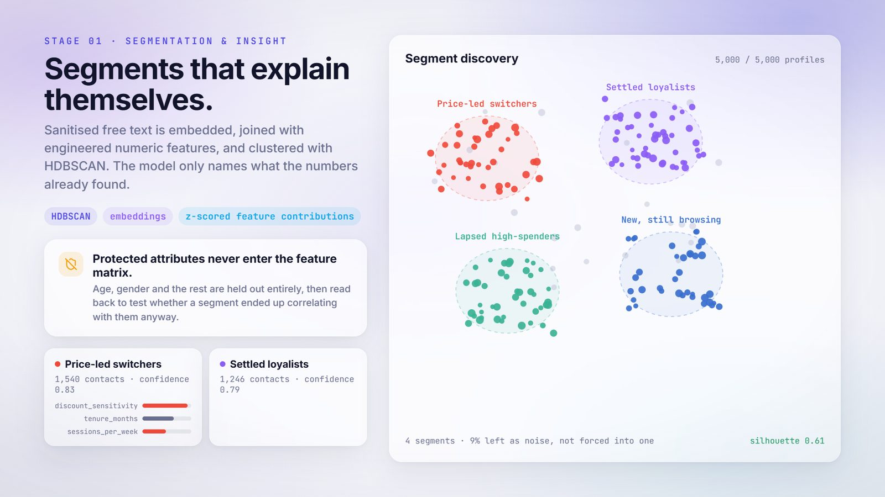
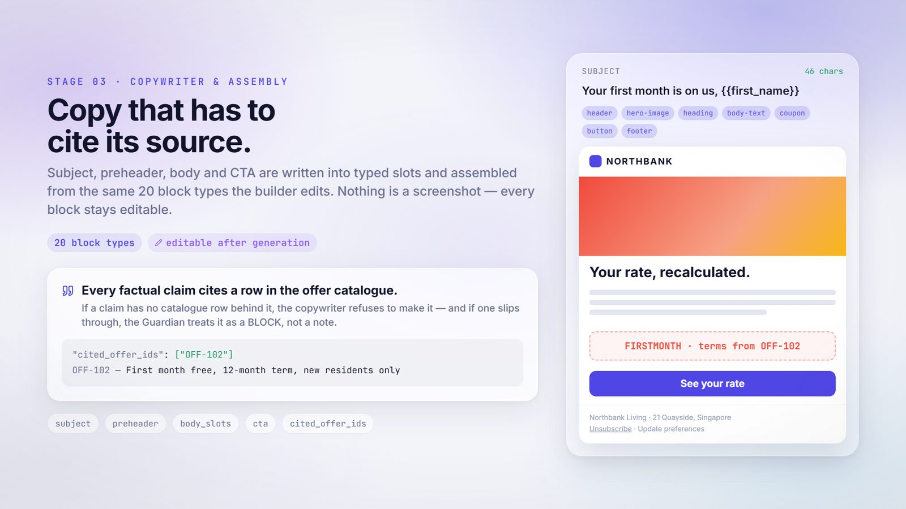
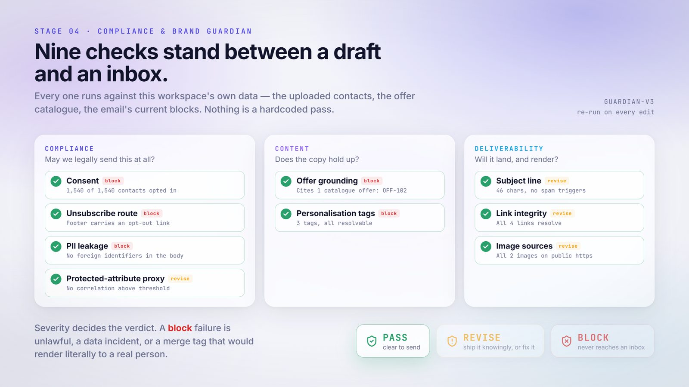
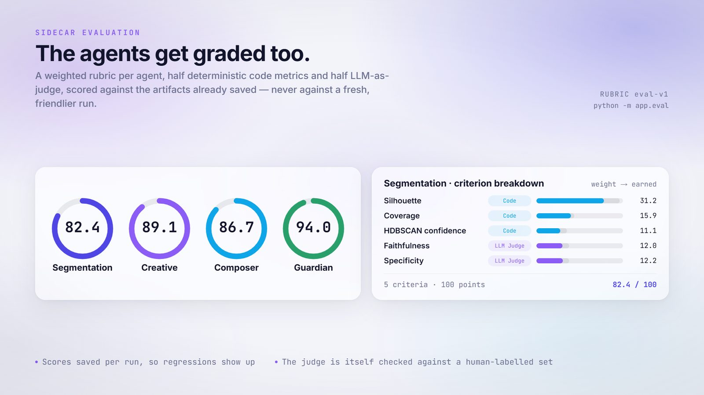

<div align="center">


# MOSAIC

**A multi-agent system for hyper-personalised email marketing.**

Four agents discover micro-segments in your own customer data, write a distinct
creative direction and email for each one, adjudicate every message against the Guardian's pre-flight checks — and then stop, because a human presses send.

NUS-ISS · Graduate Certificate in Architecting AI Systems (SWE5008) · Practice Module · **Team 13**

</div>

---

## Watch the intro

[](docs/media/mosaic-intro.mp4)

**▶ [docs/media/mosaic-intro.mp4](docs/media/mosaic-intro.mp4)** — 58 seconds, 1920×1080.
Ten scenes, in the order the console itself works.

The video is a [Remotion](https://remotion.dev) project in [video/](video/) and is
rendered from source, not edited by hand — every stage name, check name, field name and
rubric weight on screen is taken from the code it describes. Re-render it with
`cd video && npm install && npm run render`. See [video/README.md](video/README.md).

---

## The problem

A retailer with 200,000 contacts runs a campaign as three or four creative variants.
New, lapsed, high-value, everyone else. One hero image and one body of copy per variant,
and "personalisation" means dropping a first name into a fixed sentence.

The reason is cost, not preference. Every extra variant needs its own brief, design pass,
copy pass, render test and QA sign-off — the fifth variant costs about what the first one
did, so teams stop at four. A customer who buys on durability and a customer who buys on
trend both sit inside "high value" and the campaign speaks to neither.

MOSAIC treats campaign production as a **generation and assurance** problem rather than
an authoring one.

### Why four agents instead of one big prompt

| | |
|---|---|
| **Cost** | Expensive, high-variance work (segment discovery, creative direction, long copy) runs **once per segment** — O(k). Cheap deterministic work runs per recipient — O(n). n ≫ k, and that split is what makes the whole thing affordable. |
| **Separation of duties** | The Guardian sits *outside* the generators and can veto their output. A generator never grades its own compliance. |
| **Different work, different tools** | Clustering, brand-voice copywriting, block assembly and policy adjudication want different models and different evaluation methods. One context window would be a step backwards. |
| **Contained failures** | A bad creative direction re-runs one agent. A failed offer citation re-runs one email. Nothing else is thrown away. |

A single large prompt produces reasonable output and nothing anyone can audit. A
rules-based marketing platform is fully auditable but can only route content a human
already wrote — which is the constraint being removed.

---

## The pipeline



Five console tabs, each owning one stage, each **locked until the previous stage has
produced a reviewable artifact**. The nav and the route guard read the same definition
([`frontend/src/lib/pipeline.ts`](frontend/src/lib/pipeline.ts)), and the backend enforces
the same order independently ([`backend/app/routers/workspace.py`](backend/app/routers/workspace.py)),
so a pasted URL can never skip a step.

| # | Tab | Stage | What it produces | Code |
|---|-----|-------|------------------|------|
| 1 | Company Info | Intake | Company profile, brand assets, offer catalogue, uploaded contacts | [csv_ingest.py](backend/app/csv_ingest.py), [brand.py](backend/app/brand.py) |
| 2 | Segments | Segmentation & Insight | One `SegmentBrief` per cluster — name, motivation, tone, size, confidence, feature contributions | [segmentation.py](backend/app/orchestrator/agents/segmentation.py) |
| 3 | Creative Review | Creative Direction | One `CreativeDirection` per segment — tonality, language, CTA style, design style, palette | [creative_direction.py](backend/app/orchestrator/agents/creative_direction.py) |
| 4 | Email Review | Composition | One `SegmentEmail` per segment — subject, preheader, typed blocks, cited offers | [email_composer.py](backend/app/orchestrator/agents/email_composer.py) |
| 5 | Approval Queue | Adjudication → human gate → dispatch | A `GuardianVerdict` per email, then an approval, then a real send | [guardian.py](backend/app/orchestrator/agents/guardian.py), [mailer.py](backend/app/mailer.py) |

**Agents never call each other.** Every stage reads and writes a typed shared blackboard
(`WorkspaceState` in [state.py](backend/app/orchestrator/state.py)) threaded through a
LangGraph graph ([graph.py](backend/app/orchestrator/graph.py)), and each stage is also
exported on its own so a tab can re-run just its step without re-running everything
upstream. Every transition appends to the **Decision Ledger**
([ledger.py](backend/app/ledger.py)) — insert-only, carrying the prompt and model versions
live at generation time.

---

## The agents

| Agent | Owner | Autonomy | Tools |
|-------|-------|----------|-------|
| **Orchestrator** | OQQ | Least autonomous by design — plans over a fixed action space, owns shared state and the Ledger, enforces stage order and the approval gate | LangGraph runtime, ledger store, cost meter |
| **Segmentation & Insight** | OQQ | Infers the feature schema from the uploaded CSV itself, decides cluster count and granularity, emits a confidence score and a plain-language rationale per cluster | Supabase profile queries, embeddings, HDBSCAN, PCA / StandardScaler, z-scored feature contributions, protected-attribute proxy test |
| **Creative Direction** | ABP | Writes a short direction per segment under a hard JSON schema, picks an on-brand accent from the stored palette | LLM (structured output), brand profile, palette store |
| **Email Composer & Assembly** | OQQ | Model writes only content under word caps; **code** assembles the layout, applies the direction and pins logo and hero. Must cite a real catalogue offer or the Guardian blocks it | LLM (structured output), offer catalogue, block assembler, builder-compatible `EmailBlock[]` |
| **Compliance & Brand Guardian** | ABP | Adjudicates every message, can veto any generator, re-runs on every edit. No agent can override it | Consent stats, proxy-check results, offer catalogue, PII scanner, merge-tag resolver, link and image checkers |

---

## Stage 2 — segments that explain themselves



Sanitised free text is embedded, concatenated with engineered numeric and categorical
features, and clustered with **HDBSCAN**. The model is only allowed to *name* what the
numbers already found — the brief schema caps it to a 2–4 word name, one sentence of
motivation, one phrase of tone.

Nothing is hardcoded to a particular CSV. The feature schema is inferred per run
([`_feature_schema`](backend/app/orchestrator/agents/segmentation.py)): numeric columns
with real spread are standardised, low-cardinality columns are one-hot encoded at a `0.3`
weight so a wide categorical block cannot dominate Euclidean distance, embeddings are
weighted `0.5` so they sit alongside the engineered features rather than swamp them, and
constant columns, row keys and anything above 25 categories are dropped.

**Protected attributes never enter the feature matrix.** Age, gender and the rest are held
out entirely, then read back afterwards to test whether a discovered segment ended up
correlating with them anyway. A flagged segment surfaces on the Segments tab with the
attribute and the deviation, and the Guardian carries that flag forward into every email
from that segment.

HDBSCAN is allowed to leave contacts as noise rather than forcing everyone into a cluster.

---

## Stages 3–4 — direction, then composition



Creative direction is a **written direction, not a picture**: tonality, language style,
CTA style, design and shape language, palette, rationale. Each field is capped to a
phrase, because these render on compact cards.

The composer emits a real `EmailBlock[]` in exactly the shape
[frontend/src/types/email-builder.ts](frontend/src/types/email-builder.ts) defines, so the
Email Review tab hands it straight to the drag-and-drop builder with no translation layer.
The split of responsibility is deliberate:

- the **model** writes only content, under hard word limits;
- the **code** assembles the layout, applies the segment's palette and shape language, and pins the logo and hero.

A bad model response can shorten the copy. It cannot produce an unrenderable or off-brand
template. Grounding is enforced rather than trusted: any cited offer id that is not a real
`offer_catalogue` row is dropped on the way out, and an empty citation list is a hard BLOCK
at the next stage.

---

## Stage 5 — pre-flight checks stand between a draft and an inbox



These emails are dispatched for real, so every check is one that would actually stop an
operator pressing send. Each runs against *this workspace's own data* — the uploaded
contacts, the offer catalogue, the company profile, the email's current blocks. Nothing is
a hardcoded pass, and the Approval Queue re-adjudicates after every edit in the builder.

| Group | Check | Severity | Asks |
|-------|-------|----------|------|
| **Compliance** | Consent | `block` | Are these contacts opted in? |
| | Unsubscribe route | `block` | Does the footer carry an opt-out? |
| | PII leakage | `block` | Any identifier in the body belonging to someone else? |
| | Protected-attribute proxy | `revise` | Did this segment correlate with a held-out attribute? |
| **Content** | Instruction injection | `block` | Jailbreak / “ignore previous instructions” phrasing in the copy? |
| | Offer grounding | `block` | Is every claim cited to a real catalogue entry? |
| | Personalisation tags | `block` | Does every merge tag resolve? |
| **Deliverability** | Subject line | `revise` | Length, emptiness, spam triggers |
| | Link integrity | `revise` | Any placeholder or dead destination? |
| | Image sources | `revise` | Public `https`, or a `data:` URI Gmail will strip? |

Severity drives the verdict. **BLOCK** means the message must never reach an inbox —
sending without consent or without an opt-out route is unlawful, leaking another
customer's identifiers is a data incident, and an unresolved `first_name` tag renders
literally to a real person. **REVISE** is a quality problem the operator may knowingly ship
over. **PASS** is clear to send.

The check set is versioned (`guardian-v4`); the console ignores verdicts written by an
older version rather than rendering checks it no longer understands.

### The human gate

Dispatch is reachable only behind an explicit approval **plus** a non-BLOCK verdict. There
is no configuration flag that turns the gate off. Approved mail goes out through Resend
([mailer.py](backend/app/mailer.py)) to an address the operator confirms at the point of
sending, and the outcome is written back to `email_send` and the Ledger.

---

## Evaluation — the agents get graded too



A sidecar rubric (`eval-v1`) scores all four decision agents against the artifacts
**already saved** — never against a fresh, friendlier run.

| Agent | Deterministic code metrics | LLM-as-judge |
|-------|---------------------------|--------------|
| Segmentation | Silhouette 38.5 · Coverage 17.5 · HDBSCAN confidence 14 | Faithfulness 15 · Specificity 15 |
| Creative | Five field-length / hex-format checks, 8 each | Segment fit 20 · Brand fit 20 · No dark patterns 20 |
| Composer | Citation present 10 · Citations in catalogue 10 · Subject length 10 · Preheader length 10 | Follows direction 20 · Segment fit 20 · Grounded 20 |
| Guardian | Check pass rate 70 · Email PASS rate 30 | — |

Each list sums to 100. Weights live in [backend/app/eval/rubric.py](backend/app/eval/rubric.py).
Runs are saved to `eval_run`, so a regression shows up as a score that moved.

```bash
cd backend && .venv/Scripts/python.exe -m app.eval     # or POST /api/eval from the console
```

---

## Explainable and Responsible AI

| Consideration | How it is implemented here |
|---|---|
| **Fairness** | Protected attributes are excluded from the feature matrix entirely. Exclusion alone is not enough, so a proxy test correlates each discovered segment against the held-out attributes; anything above threshold is flagged on the Segments tab and carried into the Guardian's adjudication of every email from that segment. |
| **Explainability** | Each segment records the z-scored feature contributions that defined it, rendered as contribution bars. Each direction records its rationale. Each email records its cited offers and its full Guardian breakdown by check and category. The Logs tab separates *what I did* from *what the agents did*. |
| **Accountability** | The approval gate is mandatory and cannot be disabled. Dispatch refuses anything without an approval and a non-BLOCK verdict. Every decision is appended to the Decision Ledger with the prompt and model versions live at the time. |
| **Manipulation guardrail** | The creative rubric scores *no dark patterns* explicitly, and the subject-line check rejects manufactured urgency and scarcity language. The system will not tune emotional pressure against inferred vulnerability, and that limit lives in code rather than in prompt wording. |
| **Governance** | Mapped to IMDA's Model AI Governance Framework: internal governance (approval gate, named accountability), human involvement (risk-tiered human-in-the-loop), operations management (data provenance, ledger, versioning), stakeholder communication (working unsubscribe, per-email explanation). PDPA consent and withdrawal obligations are enforced at the consent check, immediately before dispatch. |

### AI-specific security risks

The threat model is concrete, because the system ingests text an attacker can influence
(free-text profile fields) and then emits content to third parties under a brand's name.

| Risk | Mitigation |
|---|---|
| **Indirect prompt injection** through customer free text | Untrusted text is sanitised and structurally delimited at ingestion and never placed in instruction position. Every model call uses a tight JSON schema with length-capped fields, so an injected instruction has nowhere to land. The Guardian scans generated copy for instruction-like artifacts. |
| **Cross-recipient PII contamination** | Each email is scanned for email addresses and phone numbers that do not belong to its segment. Severity `block`. |
| **Hallucinated offers, prices or claims** | Every cited offer id is checked against `offer_catalogue` at composition time and again at adjudication. An ungrounded claim is a BLOCK, not a REVISE. |
| **Unrendered merge tags** | Both placeholder dialects the app can produce are resolved and verified. An unresolved tag is a BLOCK — it would render literally to a real person. |
| **Consent and suppression bypass** | Consent is checked immediately before dispatch rather than at segmentation time, so a withdrawal partway through a campaign is still honoured. |
| **Cost exhaustion** | A cost meter per run, a capped segment count (`MAX_SEGMENTS`, default 6), and no unbounded generation loops anywhere in the graph. |

### Excluded on ethical grounds, enforced in code

No targeting or creative variation on inferred health status, financial distress,
bereavement, or any protected attribute. No individual price discrimination — offer value
varies by defined eligibility rules only, never by inferred willingness to pay. No
targeting of emotional vulnerability, including timing. No imagery depicting identifiable
real people, and no fabricated endorsements or testimonials.

---

## CI — MLOps and LLMSecOps

Every push and pull request runs [`.github/workflows/ci.yml`](.github/workflows/ci.yml).
No job calls OpenRouter or Supabase: the gate is deterministic and free.

| Job | What it locks |
|-----|----------------|
| **No committed secrets** | Tracked `.env` / `.env.local` files fail the build. |
| **Guardian corpus** | Fixture emails in [`backend/tests/fixtures/llmsecops/`](backend/tests/fixtures/llmsecops/) are run through the real `run_checks` / `verdict_for` path. PII, missing unsubscribe, unresolved merge tags, and instruction-injection phrasing must **BLOCK**. An offer id that is not in the catalogue must fail grounding. A clean email must **PASS**. |
| **Contracts** | Eval-v1 weights sum to 100 per agent. Segment / creative / composer JSON schemas still require their artifact fields. Prompt versions (`seg-v3`, `direction-v2`, `email-v2`, `guardian-v4`) are pinned. Protected-attribute column names stay excluded from clustering. |
| **Console lint** | `npm run lint` in `frontend/` (reported; pre-existing builder warnings are not a merge gate). |

Run the same suite locally from `backend/`:

```bash
pip install -r requirements.txt
python -m pytest -q
```

---

## Architecture

```
MOSAIC/
├── backend/                  FastAPI orchestrator (Python 3.11+)
│   └── app/
│       ├── orchestrator/
│       │   ├── graph.py      LangGraph: segmentation → creative → composer → guardian
│       │   ├── state.py      WorkspaceState — the typed shared blackboard
│       │   └── agents/       The four agents, one file each
│       ├── eval/             Sidecar rubric, LLM judge, scorecard
│       ├── routers/          workspace · image_gen · test_send · misc
│       ├── ledger.py         Append-only Decision Ledger
│       ├── mailer.py         Real dispatch via Resend
│       ├── csv_ingest.py     Schema inference + protected-column profiling
│       ├── persistence.py    Supabase reads and writes
│       └── config.py         Settings (.env)
│   └── tests/                CI corpus: Guardian fixtures + eval/schema pins
├── frontend/                 React 18 + Vite + TypeScript + Tailwind + shadcn/ui
│   └── src/
│       ├── pages/            One per pipeline tab, plus Settings and Logs
│       ├── components/email-builder/   Drag-and-drop builder, 20 block types
│       └── lib/pipeline.ts   The stage order and unlock rules
├── supabase/migrations/      0001 → 0008, applied in order
├── video/                    Remotion project for the intro video
└── docs/media/               Rendered video and stills used by this README
```

**Data flow.** Supabase Postgres is the single store: `customer_profile`, `segment_brief`,
`proxy_check_result`, `creative_direction`, `segment_email`, `offer_catalogue`, `approval`,
`email_send`, `eval_run`, `ledger_entry`, `activity_log`. The backend holds the
service-role key and is the only thing that writes pipeline state; the frontend never
talks to the database for it.

**Models.** Text generation and embeddings go through OpenRouter, configured per role in
[backend/.env.example](backend/.env.example). Image generation exists but is **never called
by a pipeline stage** — it fires only when an operator reviews a prompt and presses
Generate ([routers/image_gen.py](backend/app/routers/image_gen.py)).

---

## Running it

**Prerequisites:** Python 3.11+, Node 18+, a Supabase project, an OpenRouter key, and a
Resend key with a verified sending domain (only needed to actually dispatch).

```bash
# 1. Database — run each migration in the Supabase SQL Editor, in order
#    supabase/migrations/0001_init.sql → 0008_eval_run.sql

# 2. Backend
cd backend
python -m venv .venv && .venv/Scripts/activate      # Windows
pip install -r requirements.txt
cp .env.example .env        # OpenRouter, Supabase service role, Resend

# 3. Frontend
cd ../frontend
npm install
cp .env.example .env.local  # VITE_ORCH_API_BASE=http://localhost:8055
```

Then, from the repo root:

```powershell
./start.ps1     # backend on :8055, console on :5173, one window each
```

`start.ps1` kills whatever already owns port 8055 and its whole process tree first —
uvicorn's `--reload` parent plus its worker child means a naive kill leaves an orphan
still holding the port, which shows up as edits that appear to do nothing.

Health check: <http://localhost:8055/api/health> reports whether OpenRouter and Supabase
are configured.

**First run:** open <http://localhost:5173>, fill in Company Info, then either upload your
own CSV or load the bundled sample — 1,000 synthetic contacts across structured,
behavioural and psychographic attributes
([backend/data/mosaic_customers.csv](backend/data/mosaic_customers.csv), generated by
[synthetic_data.py](backend/app/synthetic_data.py)). Each tab unlocks as the previous one
produces output.

### API surface

| | |
|---|---|
| **State** | `GET /api/state` · `GET /api/health` · `POST /api/reset` |
| **Intake** | `GET` / `PUT /api/company` · `GET /api/audience` · `POST /api/audience/upload` · `POST /api/audience/load-sample` |
| **Pipeline** | `POST /api/segments/generate` · `POST /api/creative/generate` · `PATCH /api/creative/{id}` · `POST /api/emails/generate` · `PATCH /api/emails/{id}` · `POST /api/emails/{id}/adjudicate` |
| **Gate** | `POST /api/approvals` · `DELETE /api/approvals/{id}` · `POST /api/emails/{id}/send` |
| **Eval and ops** | `POST /api/eval` · `GET /api/logs` · `GET` / `PUT /api/settings` · `GET /api/jobs/{id}` |

Long-running stages return a job id; the console polls `/api/jobs/{id}` and renders the
agent's own progress steps ([progress.py](backend/app/progress.py)).

---

## Where the build differs from the proposal

The proposal is in [TEAM_13_Project_Proposal.docx](TEAM_13_Project_Proposal.docx) and the
build plan in [MOSAIC_APPLICATION_PLAN.md](MOSAIC_APPLICATION_PLAN.md). Four things moved
during implementation, deliberately:

1. **Creative direction replaced generated imagery.** Stage 3 emits a written direction the
   composer must follow rather than an asset set. Image generation still exists, but as an
   operator-triggered tool — no agent calls a text-to-image model, so there is no
   generate / critique / revise image loop and no per-segment asset cost.
2. **Sequential, not fan-out.** Creative and copy were to run in parallel; because the
   direction is now the composer's *input*, and because each console tab owns a stage whose
   output the operator reviews before the next one runs, the graph is strictly sequential.
3. **Per-recipient resolution is a merge-tag layer, not a stage.** Copy carries typed slots,
   the Guardian verifies every one resolves, and resolution happens at send. There is no
   per-recipient LLM call.
4. **Dispatch is real, not a sandboxed stub.** Approved mail goes out through Resend to a
   confirmed address — which is why the Guardian's check set is framed around what would
   genuinely stop a send, and why consent is re-checked immediately before it.

One implicit workspace replaces the campaign selector and the Brief Intake screen; every
pipeline table still carries `campaign_id`, satisfied by a single seeded constant.

---

## Team 13

| | |
|---|---|
| **Ong Qing Quan (OQQ)** | Engineering lead. Orchestrator, Segmentation & Insight, Email Composer & Assembly, Campaign Console, CI and versioning. |
| **Agustinus Benyamin Prasetyo (ABP)** | Domain and assurance lead. Creative Direction, Compliance & Brand Guardian, brand guideline pack, Responsible AI instrumentation, AI security test corpus. |

Self-initiated project — no external sponsor. All customer data is synthetic and generated
by us; the brand, guideline pack and offer catalogue are fabricated. 30 person-days across
August–October 2026.
