<div align="center">


# MOSAIC

**A multi-agent system for hyper-personalised email marketing.**

Four agents discover micro-segments in your own customer data, write a distinct
creative direction and email for each one, adjudicate every message against ten
pre-flight checks — and then stop, because a person presses send.

NUS-ISS · Graduate Certificate in Architecting AI Systems (SWE5008) · Practice Module · **Team 13**

</div>

---

## Practice module deliverables

| Deliverable | Where |
|---|---|
| **Group project report** | [docs/Team13_MOSAIC_Group_Report.docx](docs/Team13_MOSAIC_Group_Report.docx) · [PDF](docs/Team13_MOSAIC_Group_Report.pdf) |
| **Presentation slides** | [docs/Team13_MOSAIC_Presentation.pptx](docs/Team13_MOSAIC_Presentation.pptx) |
| Project proposal | [TEAM_13_Project_Proposal.docx](TEAM_13_Project_Proposal.docx) |
| Progress report 1 (22 Aug 2026) | [frontend/public/Team 13_22 Aug 2026.pdf](<frontend/public/Team 13_22 Aug 2026.pdf>) |
| System architecture (logical, physical, deployment, data) | [§3 below](#3-system-architecture) · report §3 |
| Agent design documentation | [§4 below](#4-agent-roles-and-design) · report §4 |
| Explainable and Responsible AI report | [§5 below](#5-explainable-and-responsible-ai) · report §5 |
| AI security risk register | [§6 below](#6-ai-security-risk-register) · report §6 |
| MLSecOps / LLMSecOps pipeline | [§7 below](#7-mlsecops--llmsecops-pipeline) · [.github/workflows/ci.yml](.github/workflows/ci.yml) · report §7 |
| Testing artifacts | [backend/tests/](backend/tests/) · [docs/ci-negative-test.md](docs/ci-negative-test.md) · report §8 |
| UI prototype | the Campaign Console in [frontend/](frontend/) · [screenshots](#9-the-console) |
| Intro video (58 s) | [docs/media/mosaic-intro.mp4](docs/media/mosaic-intro.mp4) |

**Contents:** [1 Problem](#1-the-problem) · [2 System overview](#2-system-overview) ·
[3 Architecture](#3-system-architecture) · [4 Agents](#4-agent-roles-and-design) ·
[5 Responsible AI](#5-explainable-and-responsible-ai) · [6 Risk register](#6-ai-security-risk-register) ·
[7 MLSecOps](#7-mlsecops--llmsecops-pipeline) · [8 Testing and evaluation](#8-testing-and-evaluation) ·
[9 Console](#9-the-console) · [10 Running it](#10-running-it) · [11 Changes from the proposal](#11-where-the-build-differs-from-the-proposal) ·
[12 Limitations and next steps](#12-limitations-and-next-steps) · [Team 13](#team-13)

---

## Watch the intro

[](docs/media/mosaic-intro.mp4)

**▶ [docs/media/mosaic-intro.mp4](docs/media/mosaic-intro.mp4)** — 58 seconds, 1920×1080, ten scenes in
the order the console works. It is a [Remotion](https://remotion.dev) project in [video/](video/),
rendered from source rather than edited by hand: `cd video && npm install && npm run render`.

---

## 1. The problem

A retailer with 200,000 contacts runs a campaign as three or four creative variants — new,
lapsed, high-value, everyone else. One hero image and one body of copy per variant, and
"personalisation" means dropping a first name into a fixed sentence.

The reason is cost, not preference. Every extra variant needs its own brief, design pass,
copy pass, render test and QA sign-off, so the fifth variant costs about what the first did
and teams stop at four. A customer who buys on durability and a customer who buys on
discount both sit inside "high value", and the campaign speaks to neither.

MOSAIC treats campaign production as a **generation and assurance** problem rather than an
authoring one.

### Why four agents instead of one big prompt

| | One large prompt | Rules-based platform | MOSAIC |
|---|---|---|---|
| New creative per segment | yes | no — routes copy a human wrote | yes |
| Auditability | low | high | high — typed artifact + ledger row per stage |
| Who checks compliance | the generator itself | rules on human copy | a separate Guardian with a veto |
| Failure containment | re-run everything | — | re-run one stage or one email |
| Cost profile | model call per recipient, O(n) | low | model work per segment, O(k) |

Expensive, high-variance work (segment discovery, creative direction, copy) runs **once per
segment**. Cheap deterministic work (merge tags, the cited offer) runs per recipient. n ≫ k,
and that split is what makes per-segment creative affordable. The Guardian sits *outside* the
generators and is owned by the team member who did not build them.

**Stakeholders:** campaign marketer (primary user, signs off every send), brand lead,
data protection officer (PDPA consent), legal (claims, unsubscribe), platform engineering
(cost, reliability) and customers, who are not users but carry most of the downside.

---

## 2. System overview

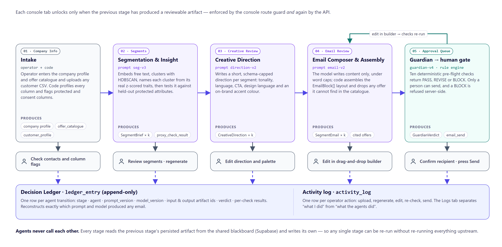

Five console tabs, each owning one stage, each **locked until the previous stage has produced
a reviewable artifact**. The nav and route guard read one definition
([`frontend/src/lib/pipeline.ts`](frontend/src/lib/pipeline.ts)) and the API enforces the same
order independently ([`backend/app/routers/workspace.py`](backend/app/routers/workspace.py)),
so a pasted URL can never skip a step.

| # | Tab | Stage | Produces | Code |
|---|-----|-------|----------|------|
| 1 | Company Info | Intake | Company profile, offer catalogue, profiled customer list | [csv_ingest.py](backend/app/csv_ingest.py), [brand.py](backend/app/brand.py) |
| 2 | Segments | Segmentation & Insight | `SegmentBrief` per cluster + proxy-test result | [segmentation.py](backend/app/orchestrator/agents/segmentation.py) |
| 3 | Creative Review | Creative Direction | `CreativeDirection` per segment | [creative_direction.py](backend/app/orchestrator/agents/creative_direction.py) |
| 4 | Email Review | Composition | `SegmentEmail` per segment — typed blocks, cited offers | [email_composer.py](backend/app/orchestrator/agents/email_composer.py) |
| 5 | Approval Queue | Adjudication → human gate → dispatch | `GuardianVerdict`, then a real send | [guardian.py](backend/app/orchestrator/agents/guardian.py), [mailer.py](backend/app/mailer.py) |

---

## 3. System architecture

### 3.1 Logical architecture

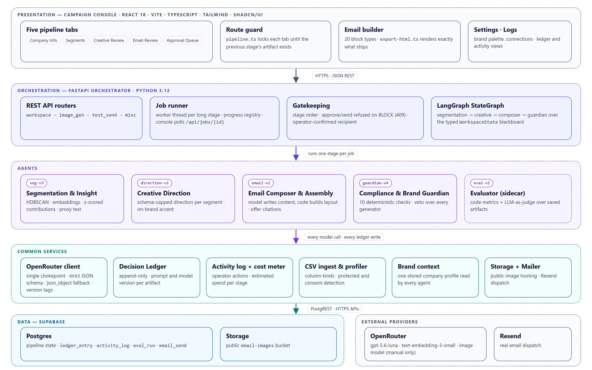

Five layers, dependencies pointing down only. The console never touches the database for
pipeline state; agents never call each other; every model call goes through one client
([`openrouter_client.py`](backend/app/openrouter_client.py)) that enforces the JSON schema,
falls back across providers, meters cost and tags versions.

### 3.2 Physical architecture and deployment

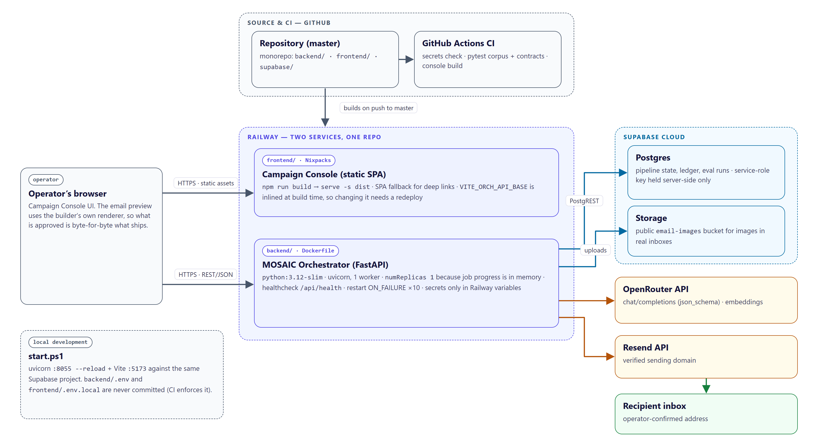

| Component | Technology | Hosting |
|---|---|---|
| Campaign Console | React 18 · Vite · TypeScript · Tailwind · shadcn/ui | Railway (Nixpacks), static SPA via `serve -s dist` |
| MOSAIC Orchestrator | Python 3.12 · FastAPI · LangGraph · scikit-learn · HDBSCAN | Railway (Dockerfile, `python:3.12-slim`), healthcheck `/api/health` |
| Database + storage | Supabase Postgres, public `email-images` bucket | Supabase cloud |
| Models | OpenRouter — `openai/gpt-5.6-luna`, `openai/text-embedding-3-small` | external API |
| Dispatch | Resend, verified sending domain | external API |

- **Two services, one repo**, each with its own Railway root directory. Full walkthrough:
  [docs/deploy-railway.md](docs/deploy-railway.md).
- **One replica, on purpose** — job progress lives in process memory
  ([progress.py](backend/app/progress.py)); scaling out needs a shared job store first.
- **Secrets stay server-side.** `VITE_*` variables ship to the browser, so they never hold a
  key; CI fails if a `.env` file is tracked.
- `VITE_ORCH_API_BASE` is inlined at **build** time, and the backend's `FRONTEND_ORIGIN` must
  list the console's domain or every call fails CORS.

### 3.3 Agent communication — a typed blackboard

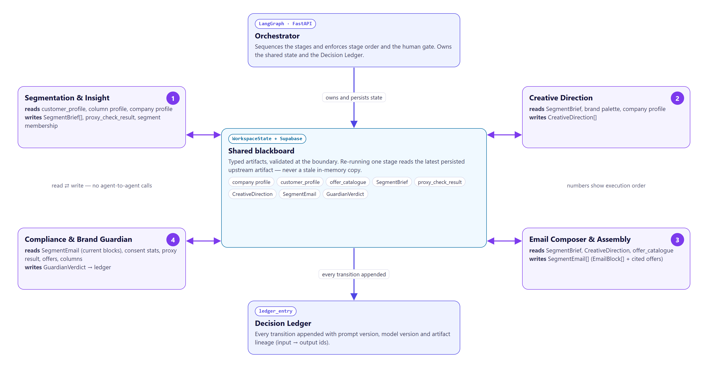

The Orchestrator threads a typed `WorkspaceState` ([state.py](backend/app/orchestrator/state.py))
through a LangGraph graph ([graph.py](backend/app/orchestrator/graph.py)): segmentation →
creative direction → composer → guardian. Each agent reads upstream artifacts and writes its
own; every artifact is persisted, so any tab can re-run just its own stage. Model output is
typed at the boundary with strict `json_schema` (retried once in `json_object` mode if a
provider rejects strict mode). Every transition appends to the **Decision Ledger**
([ledger.py](backend/app/ledger.py)) — insert-only, with prompt and model versions.

Long stages run as jobs: the API returns a job id immediately, a worker thread reports named
steps, and the console polls `GET /api/jobs/{id}`.

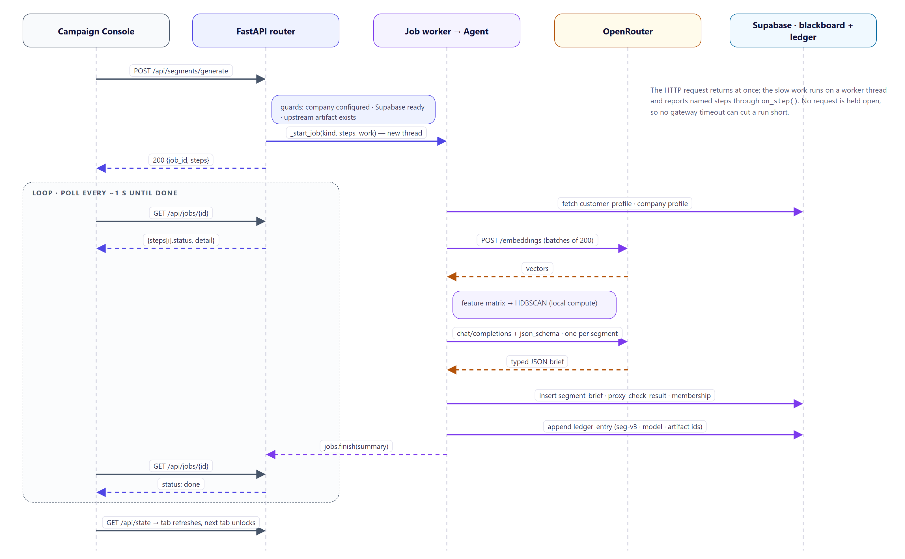

### 3.4 Data model

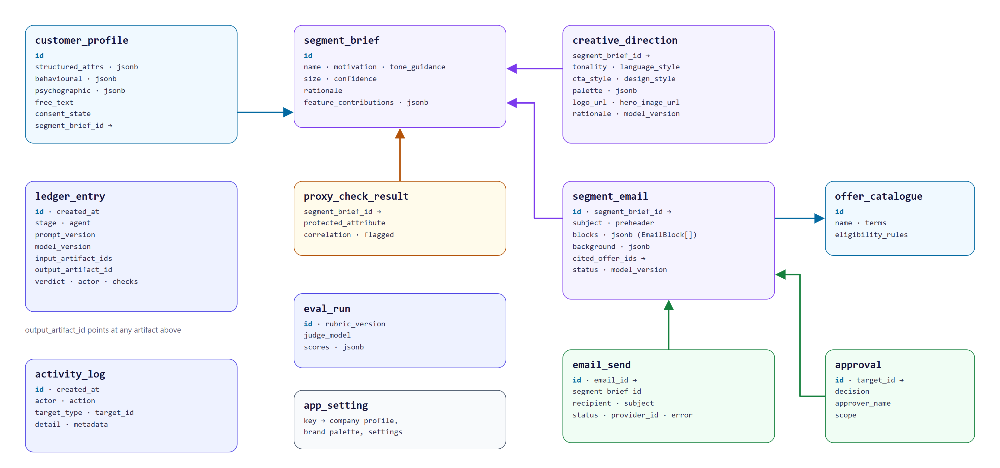

Customer attributes are stored as three JSONB groups (structured, behavioural,
psychographic) so any uploaded CSV fits without a schema change. Migrations
`0001`–`0008` in [supabase/migrations/](supabase/migrations/) are applied in order.

### 3.5 Key technology choices

| Decision | Choice | Why |
|---|---|---|
| Coordination | Blackboard with typed artifacts | each stage reviewable, re-runnable and auditable; lineage comes for free |
| Graph shape | Strictly sequential | each tab reviews the previous output; the direction is the composer's input |
| Clustering | HDBSCAN, leaf selection | no fixed k; contacts may stay as noise; membership confidence |
| Guardian | Deterministic rule engine | fast, free on every edit, testable in CI, explainable per check |
| Layout | Code assembles `EmailBlock[]` | a bad model response can shorten copy, never break the template |
| Model access | OpenRouter behind one client | one chokepoint for schema, cost and version tags |

---

## 4. Agent roles and design

| Agent | Owner | Version | Model | Tools | Autonomy |
|-------|-------|---------|-------|-------|----------|
| **Orchestrator** | OQQ | — | — | LangGraph, job runner, ledger, cost meter | least autonomous by design: fixed stage order, owns state and the gate |
| **Segmentation & Insight** | OQQ | `seg-v3` | HDBSCAN + `text-embedding-3-small`; `gpt-5.6-luna` names clusters | column profiler, PCA, z-scored contributions, proxy test | decides features, cluster count and noise from the data |
| **Creative Direction** | ABP | `direction-v2` | `gpt-5.6-luna`, strict schema | brand profile, palette store, hex validator | chooses tone, language, CTA, design language, accent |
| **Email Composer & Assembly** | OQQ | `email-v2` | `gpt-5.6-luna`, word-capped schema | offer catalogue, block assembler, merge-tag layer | chooses copy and which real offers to cite; code owns layout |
| **Compliance & Brand Guardian** | ABP | `guardian-v4` | none — rule engine | consent stats, PII scan, proxy results, catalogue, link/image checks | veto over every generator; nothing overrides BLOCK |
| Evaluator (sidecar) | OQQ | `eval-v1` | `gpt-5.6-luna` as judge | code metrics, rubric | grades saved artifacts only |

Autonomy is **bounded on purpose**: each agent makes one real, data-driven decision and emits
a schema-typed artifact; none runs an open-ended tool loop. The operator is the outer loop —
review, edit, regenerate, re-check.

### Segmentation & Insight — explain, then name

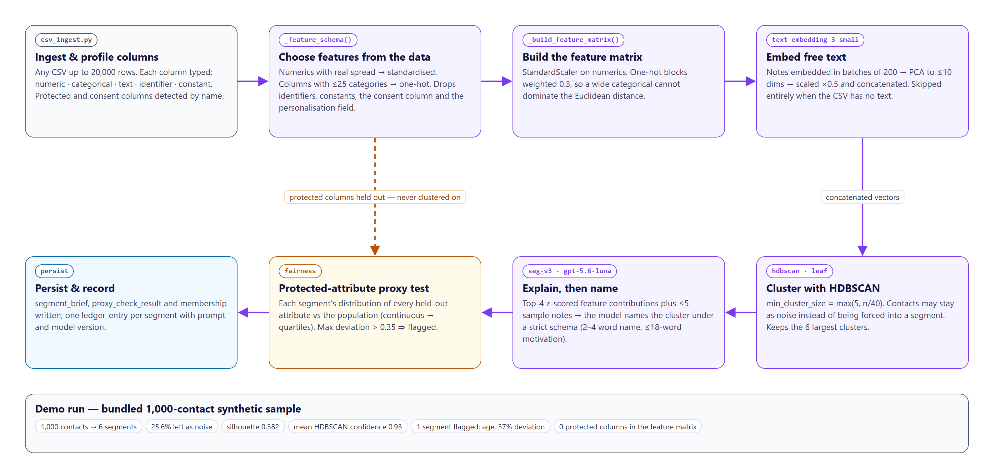

Nothing is hardcoded to a CSV: the feature schema is inferred per run
([`_feature_schema`](backend/app/orchestrator/agents/segmentation.py)). Numerics with spread
are standardised; ≤25-category columns are one-hot encoded at weight `0.3`; text embeddings
are reduced by PCA and weighted `0.5`. **Protected attributes never enter the matrix** — they
are held out and read back afterwards for the proxy test. The model only names what the
numbers found: it sees the top-four z-scored contributions and up to five sample notes, under
a schema capping the name to 2–4 words.

### Creative Direction and Email Composer — the model writes words, code builds the email

- Creative direction is a **written direction, not a picture**: six fields, each capped to a
  phrase; the accent colour is validated as hex in code; prompts forbid urgency, scarcity and
  protected attributes.
- The composer's model writes **content only**, under word caps. **Code** assembles logo →
  hero → headline → intro → three highlights → offer coupon → FAQ → CTA → footer in exactly
  the shape [email-builder.ts](frontend/src/types/email-builder.ts) defines.
- **Grounding is enforced, not trusted**: cited offer ids not in `offer_catalogue` are
  dropped; the coupon appears only when an offer is genuinely cited; the greeting merge tag is
  inserted by code.
- **Fallbacks**: strict schema → `json_object` retry; a failed call produces a clearly marked
  artifact (never a plausible fake); an invalid accent falls back to the brand palette.

### Compliance & Brand Guardian — ten checks between a draft and an inbox

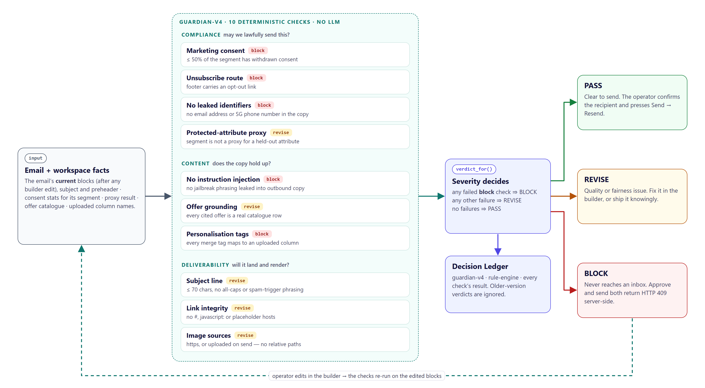

| Group | Check | Severity | Fails when |
|-------|-------|----------|------------|
| Compliance | Marketing consent | `block` | more than 50% of the segment has withdrawn |
| | Unsubscribe route | `block` | the footer carries no opt-out link |
| | No leaked identifiers | `block` | an email address or SG phone number is in the copy |
| | Protected-attribute proxy | `revise` | the segment was flagged by the proxy test |
| Content | No instruction injection | `block` | jailbreak phrasing appears in the copy |
| | Offer grounding | `revise` | no offer cited, or a cited id is not in the catalogue |
| | Personalisation tags | `block` | a merge tag names no uploaded column |
| Deliverability | Subject line | `revise` | empty, > 70 chars, all caps or spam phrasing |
| | Link integrity | `revise` | `#`, `javascript:`, placeholder host or non-http link |
| | Image sources | `revise` | relative path or plain http |

Any failed `block` check ⇒ **BLOCK** (never reaches an inbox); any other failure ⇒ **REVISE**;
none ⇒ **PASS**. The Guardian runs automatically on every composed email and again after
every edit in the builder; an edit also revokes any earlier approval. Approve and send both
return HTTP 409 for a BLOCK verdict, enforced in the API rather than only by a disabled button.
The check set is versioned (`guardian-v4`) and the console ignores verdicts from older versions.

---

## 5. Explainable and Responsible AI

| Principle | How it is implemented |
|---|---|
| **Fairness** | Protected attributes are excluded from clustering. Because exclusion alone is not enough, each segment's distribution of every held-out attribute is compared with the population (continuous attributes bucketed into quartiles); a max deviation above 0.35 flags the segment on the Segments tab and becomes a REVISE in the Guardian. |
| **Explainability** | Segments show z-scored feature contributions and a rationale; directions carry a rationale; emails show cited offers and a per-check verdict in plain language. The Logs tab separates *what I did* from *what the agents did*. |
| **Accountability** | Only a person can send, to an address they confirm. BLOCK is refused server-side. Every decision is in the append-only ledger with prompt and model versions. |
| **Manipulation guardrail** | Prompts forbid urgency, scarcity and loss framing; the subject check flags spam phrasing; the evaluator scores "no dark patterns". |
| **Data minimisation** | The composer receives no customer records; merge tags are filled locally at send time. |
| **Governance** | Mapped to IMDA's Model AI Governance Framework — internal governance (named owners, mandatory gate, CI as policy), level of human involvement (risk-tiered human-in-the-loop), operations management (provenance, versioning, evaluation), stakeholder communication (working unsubscribe, per-email explanation). PDPA consent is re-checked whenever the Guardian runs. |

**Real finding on the demo data:** "Loyal Full-Price Buyers" deviates **37% on age** from the
base rate. It is flagged, not suppressed — the system makes the correlation visible and a
person owns the decision.

**Excluded on ethical grounds:** no targeting on inferred health, financial distress,
bereavement or protected attributes; no individual price discrimination (offer value comes
only from catalogue rows); no targeting of emotional vulnerability, including timing; no
imagery of identifiable real people and no fabricated endorsements.

---

## 6. AI security risk register

Top risks, mapped to the OWASP Top 10 for LLM Applications (2025). The full 14-risk register
with evidence and owners is in the report, §6.

| Risk | Controls in place | Residual |
|---|---|---|
| Indirect prompt injection via customer free text (LLM01) | free text reaches the model only as ≤5 sample notes under a strict, length-capped schema; Guardian BLOCKs instruction-like copy; CI corpus | **Medium** — no input sanitiser yet |
| Cross-recipient PII in copy (LLM02) | composer gets no customer records; prompt forbids contact details; PII scan is BLOCK; CI test | Low |
| Hallucinated offers or claims (LLM09) | uncited ids dropped; grounding check; coupon only when cited | Low–Medium — grounding is REVISE |
| Improper output handling (LLM05) | model text goes into typed, stringified block fields; builder sanitises HTML (DOMPurify) and URL schemes | Low |
| Excessive agency (LLM06) | no agent can send; sending is a human action; BLOCK refused server-side | Low |
| Unbounded consumption (LLM10) | `MAX_SEGMENTS = 6`; no generation loops; cost meter | **Medium** — no hard budget cap |
| Secrets and supply chain (LLM03) | keys server-side only; CI rejects tracked `.env` files and live keys | **Medium** — dependencies not pinned by hash |
| Unauthenticated API | CORS allow-list | **High** — add auth and rate limits before any non-demo use |

---

## 7. MLSecOps / LLMSecOps pipeline

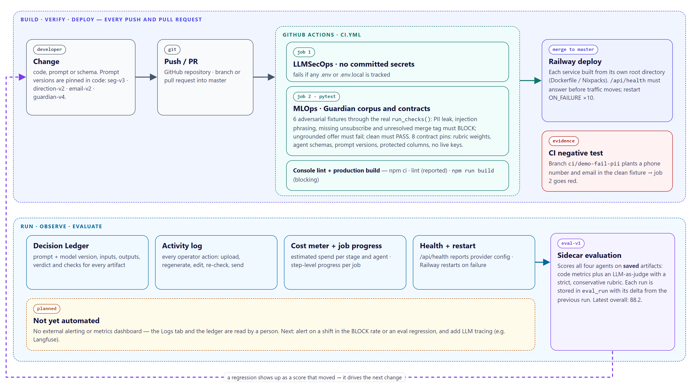

Every push and pull request runs [`.github/workflows/ci.yml`](.github/workflows/ci.yml). No job
calls OpenRouter or Supabase, so the gate is deterministic and free.

| Job | What it locks |
|-----|----------------|
| **LLMSecOps · no committed secrets** | Tracked `.env` / `.env.local` files fail the build. |
| **MLOps · Guardian corpus and contracts** | Six fixture emails in [`backend/tests/fixtures/llmsecops/`](backend/tests/fixtures/llmsecops/) run through the real `run_checks` / `verdict_for` path: PII, missing unsubscribe, unresolved merge tag and injection phrasing must BLOCK; an uncatalogued offer must fail grounding; a clean email must PASS. Contract tests pin eval-v1 weights, agent schemas, prompt versions (`seg-v3`, `direction-v2`, `email-v2`, `guardian-v4`), protected-column detection and the absence of live keys. |
| **Console lint + build** | `npm run build` must succeed (lint is reported, not blocking). |

**Negative test:** branch `ci/demo-fail-pii` planted a phone number and email in the clean
fixture and the job went red — evidence in [docs/ci-negative-test.md](docs/ci-negative-test.md).

**Versioning and audit:** prompt versions in code and on every ledger row; model ids per role
in config and on every ledger row; Guardian check-set and eval rubric versions; numbered DB
migrations. **Monitoring today:** `/api/health`, the Logs tab, the cost meter and eval runs —
read by a person. **Planned:** alerts on BLOCK-rate shifts and eval regressions, LLM tracing.

Run the suite locally from `backend/`:

```bash
pip install -r requirements.txt
python -m pytest -q        # 14 passed
```

---

## 8. Testing and evaluation

| Test | Result |
|---|---|
| Contract tests (MLOps) | 8 / 8 pass |
| Guardian corpus (LLMSecOps) | 6 / 6 pass |
| CI negative test | fails as intended |
| End-to-end run: 1,000 contacts → 6 segments → 6 emails | completed; 3 live sends via Resend |
| Guardian re-check of all six emails (guardian-v4) | 5 PASS · 1 REVISE (age proxy) · 0 BLOCK |
| eval-v1 sidecar | **88.2** overall |

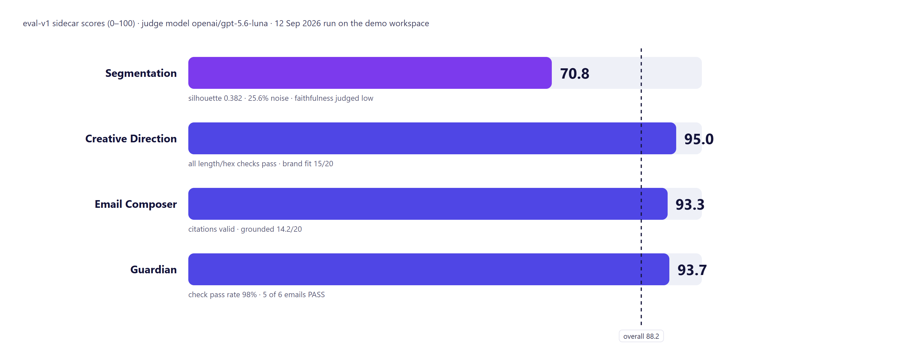

The sidecar rubric (`eval-v1`, weights in [rubric.py](backend/app/eval/rubric.py)) scores the
four agents on artifacts **already saved**, never on a fresh, friendlier run: deterministic
code metrics plus an LLM-as-judge with a conservative rubric. Segmentation is the weakest
(silhouette 0.382, 25.6% noise, segment-name faithfulness 6.9 / 15) — an honest result on
deliberately overlapping synthetic data, and the clearest improvement target.

```bash
cd backend && .venv/Scripts/python.exe -m app.eval     # or POST /api/eval from the console
```

---

## 9. The console

| Segments | Approval Queue |
|---|---|
| 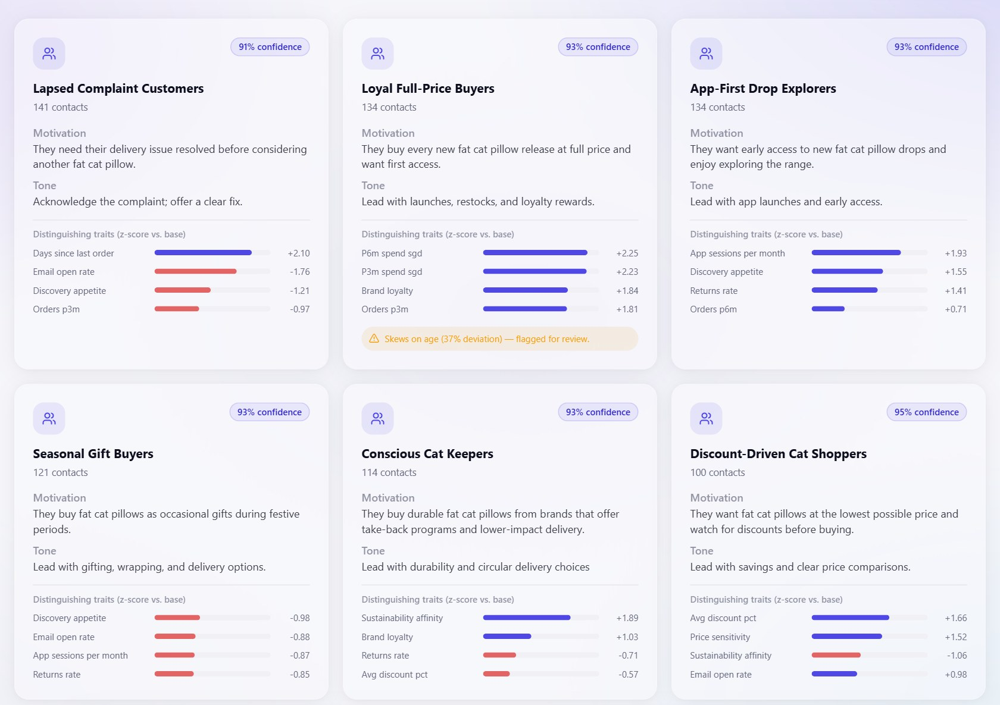 | 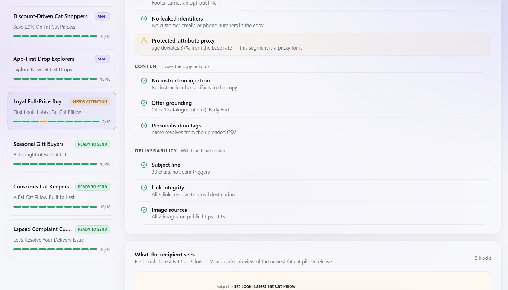 |
| **Email Review** | **Logs** |
| 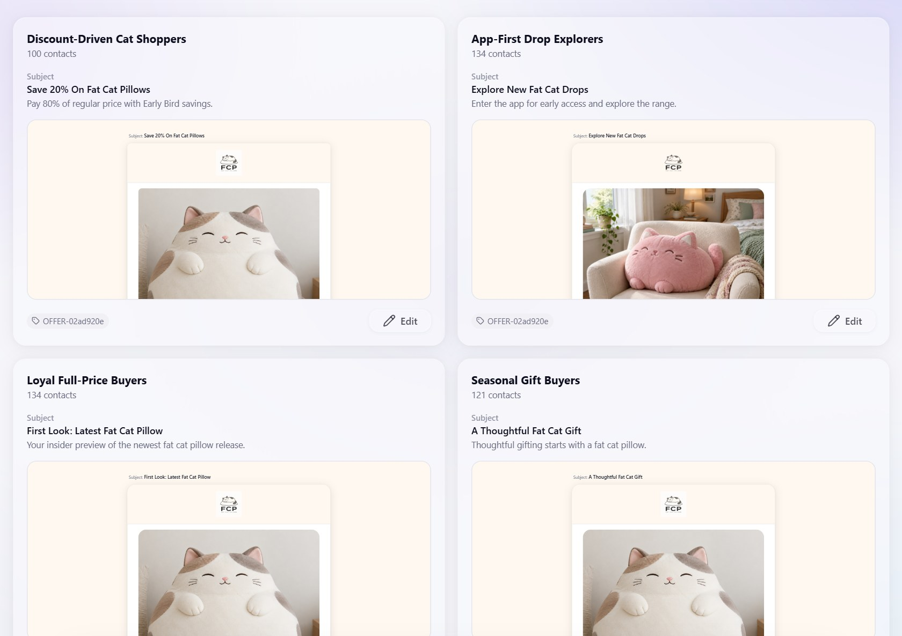 | 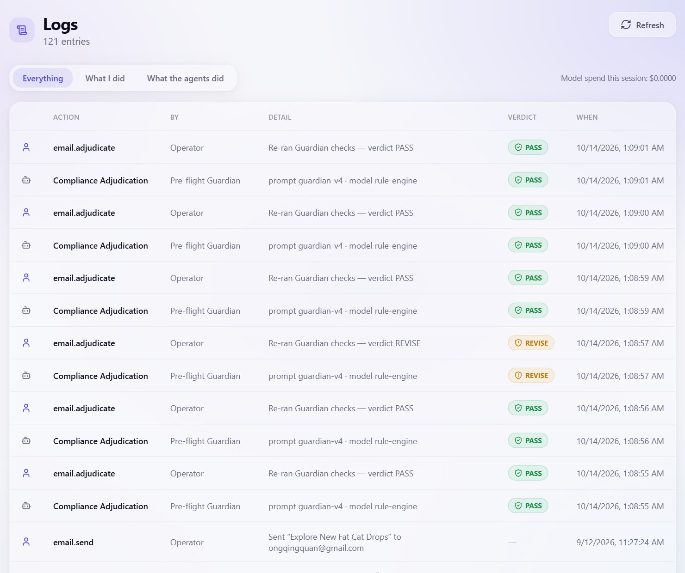 |

---

## 10. Running it

**Prerequisites:** Python 3.11+, Node 18+, a Supabase project, an OpenRouter key, and a Resend
key with a verified sending domain (only needed to actually dispatch).

```bash
# 1. Database — run each migration in the Supabase SQL Editor, in order
#    supabase/migrations/0001_init.sql → 0008_eval_run.sql

# 2. Backend
cd backend
python -m venv .venv && .venv/Scripts/activate      # Windows
pip install -r requirements.txt
cp .env.example .env        # OpenRouter, Supabase service role, Resend

# 3. Frontend
cd ../frontend
npm install
cp .env.example .env.local  # VITE_ORCH_API_BASE=http://localhost:8055
```

Then, from the repo root:

```powershell
./start.ps1     # backend on :8055, console on :5173, one window each
```

`start.ps1` first kills whatever owns port 8055 and its whole process tree — uvicorn's
`--reload` parent plus its worker child means a naive kill leaves an orphan holding the port.

Health check: <http://localhost:8055/api/health>. **First run:** open <http://localhost:5173>, fill
in Company Info, then upload your own CSV or load the bundled sample — 1,000 synthetic contacts
([backend/data/mosaic_customers.csv](backend/data/mosaic_customers.csv), generated by
[synthetic_data.py](backend/app/synthetic_data.py)). Each tab unlocks as the previous one
produces output.

### API surface

| | |
|---|---|
| **State** | `GET /api/state` · `GET /api/health` · `POST /api/reset` · `GET /api/jobs/{id}` |
| **Intake** | `GET` / `PUT /api/company` · `GET /api/audience` · `POST /api/audience/upload` · `POST /api/audience/load-sample` |
| **Pipeline** | `POST /api/segments/generate` · `POST /api/creative/generate` · `PATCH /api/creative/{id}` · `POST /api/emails/generate` · `PATCH /api/emails/{id}` · `POST /api/emails/{id}/adjudicate` |
| **Gate** | `POST /api/approvals` · `DELETE /api/approvals/{id}` · `POST /api/emails/{id}/send` |
| **Eval and ops** | `POST /api/eval` · `GET /api/logs` · `GET` / `PUT /api/settings` |

### Repository structure

```
MOSAIC/
├── backend/                  FastAPI orchestrator (Python 3.11+)
│   ├── app/
│   │   ├── orchestrator/     graph.py (LangGraph) · state.py (blackboard) · agents/ (one file each)
│   │   ├── eval/             eval-v1 rubric, LLM judge, scorecard
│   │   ├── routers/          workspace · image_gen · test_send · misc
│   │   └── *.py              ledger · openrouter_client · csv_ingest · brand · mailer · persistence
│   └── tests/                LLMSecOps Guardian corpus + MLOps contract pins
├── frontend/                 React 18 + Vite + TypeScript + Tailwind + shadcn/ui console
├── supabase/migrations/      0001 → 0008, applied in order
├── docs/                     report, slides, deployment guide, CI evidence, diagrams, screenshots
├── video/                    Remotion source for the intro video
└── .github/workflows/ci.yml  the CI gate
```

---

## 11. Where the build differs from the proposal

The proposal is [TEAM_13_Project_Proposal.docx](TEAM_13_Project_Proposal.docx). These changes
were deliberate:

1. **Creative direction replaced generated imagery.** Stage 3 emits a written direction the
   composer must follow. Image generation still exists, but only when an operator reviews a
   prompt and presses Generate — no agent calls an image model.
2. **Sequential, not fan-out.** The direction is the composer's input, and each tab reviews
   the previous output before the next runs.
3. **Per-recipient resolution is a merge-tag layer, not a stage.** The Guardian verifies every
   tag resolves; resolution happens at send. There is no per-recipient LLM call.
4. **Dispatch is real, not a sandboxed stub.** Approved mail goes out through Resend to an
   address the operator confirms — which is why the Guardian's checks are ones that would
   genuinely stop a send.
5. **One builder renderer instead of MJML**, so what the operator approves is byte-for-byte
   what ships; **a cost meter instead of budget ceilings**; and **a human-driven revise loop**
   (edit → automatic re-check) instead of an automated one.

One implicit workspace replaces the campaign selector; every pipeline table still carries
`campaign_id`, satisfied by a single seeded constant.

---

## 12. Limitations and next steps

- Demonstrator, not production-hardened: **no authentication or rate limiting**, one replica,
  20,000-row upload cap, not load-tested.
- Each send delivers one rendered email to a confirmed address; bulk delivery would need
  per-recipient consent filtering.
- Next: a bounded Guardian → Composer revise loop; retry and fallback model in the OpenRouter
  client; auth with named approvers, rate limits and a budget cap; a shared job store; an
  ingest-time injection scan; alerts on BLOCK-rate shifts and eval regressions; judge
  calibration against human labels.

---

## Team 13

| | |
|---|---|
| **Ong Qing Quan (OQQ)** | Engineering lead. Orchestrator, Segmentation & Insight, Email Composer & Assembly, Campaign Console, CI, versioning and deployment. |
| **Agustinus Benyamin Prasetyo (ABP)** | Domain and assurance lead. Creative Direction, Compliance & Brand Guardian, synthetic data and brand content, Responsible AI instrumentation, AI security test corpus. |

Self-initiated project — no external sponsor. All customer data is synthetic and generated by
the team; the brand and offer catalogue are fictional. 30 person-days, August–October 2026.
